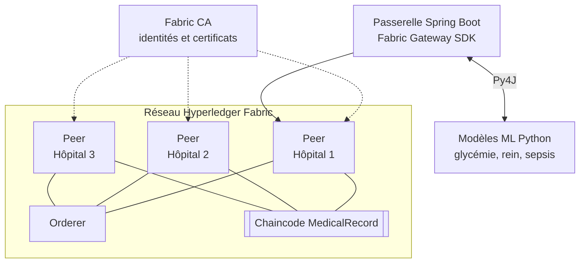

<p align="right"><a href="README.md">EN</a> | <b>FR</b></p>

# Blockchain Health

Prototype de partage de dossiers médicaux basé sur Hyperledger Fabric : les hôpitaux partagent les dossiers des patients via une blockchain permissionnée, et des modèles de machine learning assistent le diagnostic à partir de ces données. Pensé pour le système de santé marocain, où l'historique d'un patient est dispersé entre plusieurs établissements.


## Architecture



| Module | Contenu |
|---|---|
| [`blockchain_network`](blockchain_network) | Topologie du réseau (un orderer, trois organisations hospitalières), génération du matériel cryptographique via la Fabric CA, application Spring Boot utilisant le Fabric Gateway SDK |
| [`SPRING_account_model_cc`](SPRING_account_model_cc) | Chaincode Java (smart contract) qui enregistre et lit les dossiers médicaux par patient et par organisation |
| [`AI_Models`](AI_Models) | Modèles de prédiction Python et assistant d'orientation à partir des symptômes |
| [`spring.compose.io`](spring.compose.io) | Déploiement Docker Compose de l'application avec PostgreSQL, Adminer et une sauvegarde `pg_dump` quotidienne |

## Blockchain

- **Réseau permissionné :** chaque hôpital est une organisation Fabric avec son propre peer et ses propres identités (MSP), délivrées par une autorité de certification.
- **Chaincode `MedicalRecordChaincode` :** transactions `createMedicalRecord` et `getMedicalRecord`, avec un dossier identifié par patient et par organisation. Chaque écriture est endossée par les peers et conservée dans un registre immuable.
- **Traçabilité :** un dossier ne peut être ni modifié ni supprimé sans laisser de trace, un point essentiel pour des données médicales sensibles.

## Machine learning

| Modèle | Algorithme | Prédiction |
|---|---|---|
| Glycémie | XGBoost | Risque glycémique à partir des signes vitaux (glycémie, tension, fréquence cardiaque, SpO2) |
| Rein | XGBoost | Évolution de la maladie rénale chronique (créatinine, DFG, tension, IMC) |
| Sepsis | Régression logistique | Risque de sepsis |
| DoctorX | NLTK | Suggère une spécialité médicale et un médecin à partir des symptômes décrits |

Les modèles entraînés sont sérialisés avec `joblib` et exposés à l'application Java via **Py4J**, ce qui permet d'appeler les modèles Python directement depuis Java.

## Démarrage

**Réseau Fabric**

```bash
cd blockchain_network/src/main/java/com/project/blockchain_network
docker compose -f CertificateAuthorities/docker-compose.yaml up -d
docker compose -f network_topology/docker-compose.yaml up -d
```

Le générateur de matériel cryptographique lit les identifiants de la CA dans `FABRIC_CA_ADMIN_USER` et `FABRIC_CA_ADMIN_PASSWORD` (et éventuellement `FABRIC_CA_URL`).

**Chaincode**

```bash
cd SPRING_account_model_cc/java_account_model_cc
./gradlew shadowJar
```

**Application et base de données**

```bash
cd spring.compose.io
cp .env.example .env   # renseigner POSTGRES_USER, POSTGRES_PASSWORD, POSTGRES_DB
docker compose up -d
```

**Modèles ML**

```bash
cd AI_Models/javacommunication/glucose_model
pip install py4j xgboost scikit-learn joblib
python app.py
```

## Équipe

**Amine Saber**, **Houssam Chahidi** et **Youssef Ezzahnouni**.
